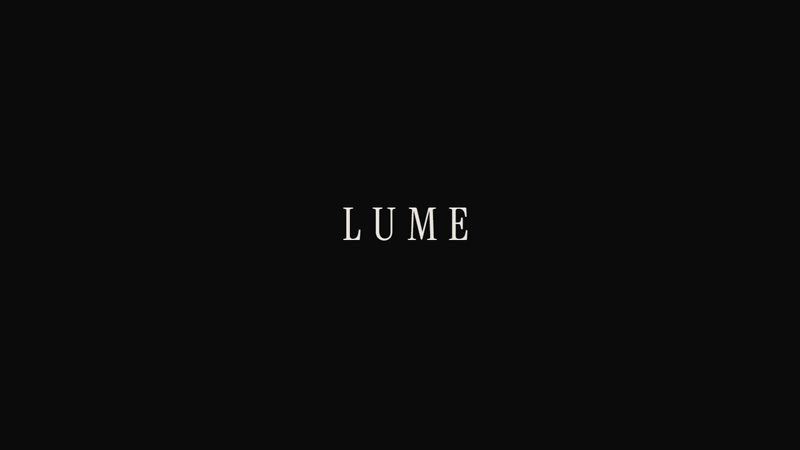

# LUME

**English** · [Português](README.pt-BR.md)

A single-page brand site for **LUME**, a fictional minimalist luxury watch brand.
A front-end portfolio project.

> Time, quietly.

**Live:** https://lume-psi-three.vercel.app



---

## Stack

| | |
|---|---|
| Framework | Next.js 15 (App Router) + TypeScript |
| Styling | Tailwind CSS v4 (no component library) |
| Animation | GSAP 3 + ScrollTrigger, `@gsap/react` |
| Smooth scroll | Lenis |
| Fonts | `next/font`: Instrument Serif (display) and Geist Sans (body) |
| Image pipeline | sharp (a build script, not a runtime dependency) |

No shadcn, MUI or headless kits: every component is written from scratch.

## Setup

Requires Node.js 20.9 or newer (sharp needs it).

```bash
npm install
npm run dev      # http://localhost:3000
```

The derived files (`/public/movimento` and `/public/og.jpg`) are committed, so the
Vercel build does not depend on the script. Run `npm run layers` again only when a file
in `/public/Engrenagens` or the hero changes.

```bash
npm run build    # production build
npm run start    # serve the build
npm run lint     # ESLint (next/core-web-vitals + typescript)
```

## Structure

```
app/
  layout.tsx           fonts, metadata/OG, skip link, shell
  page.tsx             section composition
  globals.css          the whole design system
  robots.ts · sitemap.ts
components/
  SiteShell.tsx        context (ready, scroll lock, scrollTo) + loader + header
  Header.tsx           fixed bar, scroll spy, scroll states
  MobileMenu.tsx       fullscreen menu with focus trap and scroll lock
  Loader.tsx
  StructuredData.tsx   JSON-LD: Brand, WebSite and the 3 Products
  ui/                  Container · Eyebrow · Button · SectionMark
  sections/            Hero (+ HeroShell) · Manifesto · Movement · Collection
                       Detail · Lifestyle · Footer
hooks/
  useSmoothScroll.ts   Lenis on the GSAP ticker + programmatic scrollTo
  useScrollSpy.ts      current section for the header's aria-current
  useSplitLines.ts     hand-rolled SplitText + line-by-line reveal
  useHorizontalScroll.ts  pin + translate X + progress + keyboard focus
  useParallax.ts · useReveal.ts · useMagnetic.ts
data/
  watches.ts           catalog of the 3 models (no image paths)
lib/
  images.ts            EVERY image path, as constants
  movement.ts          geometry and motion of the movement's 17 layers
  nav.ts               navigation and contact: single source for header, menu and footer
  site.ts              url, name and description: single source for metadata and JSON-LD
  gsap.ts              plugins, the "lume" easing, matchMedia conditions
scripts/
  prepare-movement-layers.mjs
```

## Images

No component builds a path string: everything goes through `lib/images.ts`.

### Originals (as delivered, unmodified)

| Folder | File | Size | Used for |
|---|---|---|---|
| `/hero` | `hero-desktop.png` | 1672×941 | Hero, desktop |
| `/hero` | `hero-mobile.png` | 941×1672 | Hero, mobile |
| `/vitrini` | `vitrini 3.png` | 1086×1448 | **LUME 01 · Bone** |
| `/vitrini` | `vitrini 2.png` | 1086×1448 | **LUME 02 · Slate** |
| `/vitrini` | `vitrini.png` | 1086×1448 | **LUME 03 · Brass** |
| `/foto-relogio` | `macro.png` | 1672×941 | Detail (split screen) |
| `/foto-relogio` | `relogio paisagem.png` | 1536×1024 | unused |
| `/foto-relogio` | `watch.png` | 1122×1402 | unused |
| `/lifestyle` | `lifestyle.png` | 1086×1448 | Lifestyle (full bleed) |
| `/lifestyle` | `lifestyle braço.png` | 1122×1402 | unused |
| `/Engrenagens` | 17 PNGs | 1254×1254 | source of the movement layers |

> **The showcase does not follow the file names.** Checked image by image against each
> model's description: `vitrini.png` is the Brass (brass + cognac leather),
> `vitrini 2.png` is the Slate (grey dial + steel bracelet) and `vitrini 3.png` is the
> Bone (off-white dial + black leather). Matching them alphabetically would swap the Bone
> and the Brass.

### Derived (generated by `npm run layers`)

| Output | Source |
|---|---|
| `/movimento/01-mainplate.png` … `/movimento/17-crystal.png` | `/Engrenagens/*` |
| `/og.jpg` (1200×630) | `/hero/hero-desktop.png` |

## Why the movement layers are derived

The 17 PNGs in `/Engrenagens` **have no alpha channel**: they were rendered on a black
background (`channels: 3`, corners at `(0,0,0)`). Stacked with
`position: absolute; inset: 0`, each layer would be an opaque square covering everything
beneath it, and only the crystal would show.

`scripts/prepare-movement-layers.mjs` fixes this in two steps.

**1. Alpha derived from luminance.** The black background becomes transparent and the
part stays opaque. RGB is kept as is, with no *unpremultiply*: the parts are not renders
with baked-in alpha, they are images where dark means dark material, and dividing RGB by
alpha would brighten every shadow. A welcome side effect: holes, cutouts and the gaps
between spokes are black too, so they become transparent, which is exactly what a stacked
exploded view needs.

**2. Recentering on the rotation axis.** `transform-origin: center center` rotates around
the center of the file, and on several parts the axis is not there. The image is pasted
onto a larger canvas, centered on the pivot, using one of three strategies:

| Strategy | Parts | How it finds the axis |
|---|---|---|
| `bbox` | barrel, 4 gears, escape wheel, balance | center of the bounding box (round parts) |
| `widest` | the 3 hands | the widest row is the mounting ring (hour y≈915, minute y≈1020, seconds y≈809) |
| `jewel` | rotor, pallet fork | centroid of the gold pixels, which is the bushing/jewel (rotor y≈463, pallet fork y≈536) |

Without this the hands would orbit the center of the dial instead of pivoting on it.

## Design system

### Color: semantic tokens, not literals

The palette has five colors, but no component uses `bg-ink` or `text-bone/85`. They all
use the semantic layer:

```
--color-canvas         section background
--color-surface        raised surface (background of a loading image)
--color-content        primary text
--color-muted          secondary text
--color-subtle         tertiary text
--color-line           dividers
--color-line-strong    heavier dividers
--color-accent         brass: prices, focus, active states
```

The Manifesto is the only light section, and it is just `data-theme="light"` on the
`<section>`: the same tokens are redefined for its children, and the `text-muted` that
gave 5.7:1 on ink now gives 5.6:1 on bone without any component knowing about it. Before,
the same problem was solved with a special token (`--graphite`) applied by hand to every
element in the section.

### Typography: eight steps, and almost nothing outside them

`mark` · `mark-sm` · `display` · `title` · `subtitle` · `lead` · `body` · `caption`, all
using `clamp()`. The five one-off `text-[clamp(…)]` values that existed in the cards and
the footer became `subtitle` and `mark-sm`. Two remain, both deliberate and used once: the
loader wordmark and the mobile menu links, which scale with the viewport as a composition
decision.

### Layout: a container with a ceiling

```
--gutter       clamp(1.5rem, 7vw, 8rem)
--content-max  88rem
--edge         max(gutter, (100% − content-max) / 2)
```

`.container-lume` caps the content column: without the ceiling, a 2560px monitor opened a
2150px line of text. `--edge` is the same distance from the edge, exposed so the full-bleed
sections (the horizontal gallery, the movement stage) line up with the vertical line of the
rest of the page instead of the raw margin. It uses `%` and not `vw` because `vw` includes
the scrollbar.

Vertical rhythm: `section-y` and `section-y-lg`. No one-off `py-[18svh]`.

### Named z-index

`z-content` (10) · `z-sticky` (20) · `z-header` (50) · `z-overlay` (80) · `z-loader` (90)
· skip link (100). Nobody has to guess whether 40 sits above 50.

### Motion

`cubic-bezier(0.16, 1, 0.3, 1)` is registered in GSAP as the `"lume"` easing, so CSS and
JS produce exactly the same acceleration. Durations follow the Tailwind scale
(500/700/1000ms), with no `duration-[830ms]`.

### Primitives

`Container` · `Eyebrow` · `Button` (solid/outline/ghost, optionally magnetic, 44px target)
· `SectionMark`. No abstraction for its own sake: these are the four patterns that really
repeat.

The `SectionMark` (number, rule and label) appears in the four inner sections, and it is
what makes the page read as a document instead of stacked components. The animation lives
inside it, not in the sections, so the gesture is identical in all four places without
anyone having to remember to call a hook.

## Header and mobile menu

Before, there was no navigation at all above the footer.

**A fixed bar with two states.** `data-scrolled` turns on the background and border when
leaving the top; `data-hidden` tucks the bar away while scrolling down and brings it back
on the way up. The criterion is **velocity**, not direction: with `direction` the bar
would flicker on every trackpad micro-oscillation and, worse, inside the pinned sections,
where the scrub flips the sign all the time.

Both states are attributes on a `.site-header` class, not utilities, and that came out of
debugging: when it takes over transforms, GSAP writes `translate: none` inline, which
cancelled the bar's `-translate-y-full`. The entrance animation moved to the inner element,
and the `<header>` kept the `translate` property to itself.

**Scroll spy** with an `IntersectionObserver` on a narrow band just below the header, not
by visible area. With the Movement section taking 300vh of pin, the area criterion would
pick it as the current section almost all the time.

**Fullscreen mobile menu:** a `clip-path` curtain, links rising from under a mask
(opposite directions, so it reads as two layers), a focus trap with circular Tab, Esc to
close, focus returned to the button that opened it, and a scroll lock that also works for
people with reduced motion. In that case Lenis is never instantiated, so the lock goes on
an attribute on `<html>`.

## The Movement section

A scroll-driven teardown of the movement: the watch starts whole, opens layer by layer,
shows the mechanism turning and puts itself back together.

**Three divs per part, one job each.** `.mv-place` positions and scales (static CSS),
`.mv-boom` pulls it away on scroll (GSAP: `scale` + `opacity`), `.mv-spin` rotates it.
Splitting them is mandatory: both effects write `transform`, and on a single element one
would kill the other.

**Measured scales, not guessed ones.** The parts all came at the same diameter, each one
filling its own canvas. Raw, the 48-tooth gear is the size of the case. I measured the
real radius of the content inside each PNG (the alpha bounding box) and solved
`scale = target_radius / (measured_radius / side)`, with the case at a ~0.43 radius, the
dial at ~0.335 and the mainplate at ~0.325: the proportions of a real 38 mm movement. The
`x`/`y` offsets take the gear train off the central axis; the distances between
neighboring centers are the sum of the radii, which is the condition for two sets of teeth
to mesh.

**Continuous rotations in CSS, oscillations in GSAP.** The seven infinite rotations
(barrel 240s, 48 teeth 120s ⟲, steel 24 teeth 60s, 12 teeth 30s ⟲, brass 24 teeth 60s,
escape wheel 10s, rotor 8s) are linear `@keyframes`: composited on the GPU, no main-thread
cost, and they switch off on their own under `prefers-reduced-motion`. The balance (±30°)
and the pallet fork (±8°) stay in GSAP because `sine.inOut` in a yoyo is the real velocity
profile of an oscillator: fast in the middle of the swing, still at the ends. Both use the
same 0.4s period, because the balance is what drives the pallet fork.

**A timeline with duration 1.** Positions read directly as scroll progress: 0.30 on the
timeline is 30% of the pinned stretch (300vh on desktop, 200vh on mobile).

| Progress | What happens |
|---|---|
| 0% | complete watch |
| 5–15% | crystal and case pull away (`scale` 1 → 1.15, `opacity` → 0) |
| 15–30% | hands and dial pull away |
| 30–45% | rotor and bridges pull away |
| 46–72% | exposed mechanism turning, text on the left |
| 70–100% | layers come back in reverse order |

**`sizes` derived from the layer's scale.** Every layer fills the whole stage in layout;
what shrinks it is a `transform`, which the browser ignores when picking from the srcset.
Without the fix, the 12-tooth wheel rendered at 60px would download a 700px file,
seventeen times. With the fix it asks for 128px: **3 KB in AVIF instead of 21 KB**.

## Other animation decisions

- **Hero with real art direction.** Desktop and mobile are different files, not crops.
  Since `next/image` does not emit `<picture>`, `getImageProps` provides each one's
  optimized `srcSet` and the `<picture>` is built by hand: the browser picks the source
  before layout, and neither file is downloaded for nothing.
- **Loader → Hero.** The loader publishes `ready` through context; the Hero only plays its
  entrance after that, and the wordmark continues from a wider tracking, as if the opening
  screen had dissolved over it. The end of the loader is also what releases Lenis, so it
  has a `setTimeout` safety net (2s): GSAP runs on `requestAnimationFrame`, which the
  browser freezes in background tabs. Without the net, anyone who opened the site in a tab
  that was not in front would find the loader stuck and the scroll locked.
- **Detail: the plate sets the frame, not the other way around.** The photo keeps its
  native ratio and takes the full width of the column; it is the column that is taller
  than the photo, and the leftover vertical ink is the parallax travel. The usual approach
  (an image in `cover` inside a 100svh column) does the opposite: it scales the photo by
  height and, from a 16:9 file, shows only the middle strip, enlarged. Here there is no
  side crop and no upscaling.
- **Hand-rolled SplitText.** The official plugin is paid. The text stays in the HTML as
  running text (SEO, screen readers, no-JS) and the split happens after mount: the grouping
  into lines comes from the `offsetTop` measured by the browser, and a `ResizeObserver`
  redoes everything when the width changes. The effect follows `clamp()` and any viewport
  without a single media query.
- **Lenis on the GSAP ticker.** One rAF for both: with two loops ScrollTrigger reads
  positions from the previous frame and the parallax jitters. `lagSmoothing(0)` because
  GSAP's lag compensation makes the scroll jump.
- **Collection.** The card width is derived from the viewport height (`42svh` → a 3:4
  image), which guarantees the whole card fits in `100svh`, the condition for the
  horizontal pin not to cut off the footer. The gallery only exists under the `gallery`
  variant (≥768px wide, ≥640px tall and motion allowed); CSS and GSAP's `matchMedia` use
  literally the same condition, otherwise the CSS would clip the section without the pin
  existing and two models would be unreachable.
- **Keyboard-accessible collection.** The track is *translated*, not scrolled, so the
  browser cannot bring a card that received focus by Tab into view, and a keyboard user
  would be typing in the dark. Since the horizontal offset is 1:1 with the pin's vertical
  scroll, a `focusin` listener adds the same number of pixels to the page scroll. Each card
  also got a real destination (`Consultar`, with a prefilled subject) and hover and focus
  states; before, they were decorative blocks with no action.
- **Progress in the pins.** A 1px rule at the bottom of both pinned sections follows
  `self.progress`. In a 300vh pin the user has no way to know how much is left, and without
  that signal the section feels stuck instead of long.
- **Lifestyle.** The reveal is a `clip-path`, not a scale: the image does not move, the
  window it shows through does.
- **Cursor parallax in the Hero.** 24px of travel on the photograph, via `quickTo` (one
  reused tween, nothing allocated per mouse move), only on `pointer: fine`. And the
  magnetic button listens to `pointermove` on the document, not `mouseenter` on the
  element: the pull starts before the cursor touches the button, which is what makes it
  feel like a magnet instead of a jump on hover.
- **Component classes in `@layer components`.** Unlayered CSS beats *any* Tailwind
  utility, regardless of specificity. While `.parallax-frame` was outside a layer, its
  `position: relative` silently cancelled the `md:sticky` of the Detail column, and the
  column never stuck. Inside the layer, the order is back to what you expect: the utility
  beats the class.

## Accessibility and performance

- `prefers-reduced-motion: reduce` turns off GSAP, Lenis, the movement pin and every
  rotation; the page becomes static and complete, with the watch assembled.
- No initial animation state lives in an HTML class: everything is applied by `gsap.set`
  inside the effect. If JS fails, the content shows instead of staying stuck at
  `opacity: 0`. The loader has a `<noscript>` rule for the same reason.
- Semantic HTML (`section` + `aria-labelledby`, `dl` for specifications), a skip link,
  visible focus in `--brass`, AA contrast in every combination. The movement stage is a
  `role="img"` with a description, and the 17 parts are listed as an `sr-only` list.
- 44px touch targets on every link and button, through a `tap-target` utility that grows
  the hit area with a pseudo-element: the text keeps the design's line-height and nothing
  in the layout moves.
- GSAP only inside `useGSAP`: nothing runs during SSR, zero hydration errors.
- `next/image` everywhere, AVIF before WebP; the hero with `priority`, the rest lazy.
- The `will-change` of the movement's 34 layers is turned on and off by the ScrollTrigger
  itself (`onToggle`). Left on, it would hold 34 compositing layers for the whole page.
- **No global `overflow-x: hidden`.** It existed and masked horizontal overflow instead of
  fixing it. It was removed, and the page was measured at 15 widths, from 320px to 2560px,
  with zero overflow at every one.

## SEO

`title`, `description`, canonical, Open Graph and Twitter card in `app/layout.tsx`, all fed
by `lib/site.ts`. On top of that, `robots.ts`, `sitemap.ts` and JSON-LD (`Brand`, `WebSite`
and one `Product` per model). The structured data prices come from the same
`data/watches.ts` the page renders, so the markup and the visible content cannot drift
apart.

## License

The code is under the [MIT](LICENSE) license. The images in `/public` and the LUME brand
are not included: the project is fictional, made for a portfolio, and LUME is not a real
brand.

## Dependencies

`npm audit --omit=dev` still flags the `postcss` 8.4.31 bundled inside Next 15. It only
processes the project's own CSS at build time, never third-party input, so the described
vectors (source maps and attacker-controlled CSS) do not apply. The fix is Next 16.
